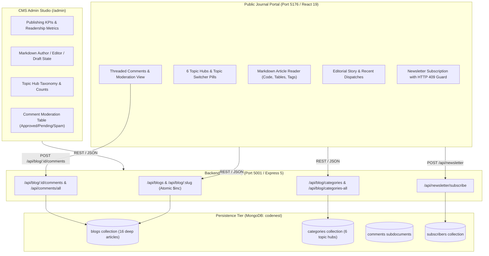

# 🪶 CodeNest — Developer Tech Editorial & Publishing Platform

[](https://react.dev/)
[](https://www.typescriptlang.org/)
[](https://nodejs.org/)
[](https://expressjs.com/)
[](https://www.mongodb.com/)
[](https://tailwindcss.com/)
[](https://vitejs.dev/)

> **Modern Engineering Publication & Content Management System with Markdown Engine & Topic Hubs**  
> **Status:** 100% Operational & Populated Across All Engineering Topics  
> **Frontend:** `http://localhost:5176` | **Backend API:** `http://localhost:5001` | **Database:** `mongodb://127.0.0.1:27017/codenest`

---

## 📖 Overview

**CodeNest** is an enterprise-grade developer tech editorial and publishing platform tailored for software engineering teams, systems architects, and technical writers. Built using **React 19**, **TypeScript**, **Tailwind CSS**, and **Vite** on the frontend, and powered by a resilient **Node.js + Express 5 + MongoDB** backend API, CodeNest combines an immersive public journal experience with an executive **CMS Studio**.

The platform features 6 premier topic hubs containing 16 comprehensive, production-grade technical articles complete with Markdown body rendering, syntax code blocks (`typescript`, `bash`, `nginx`, `yaml`), atomic read/like tracking in MongoDB, threaded discussions with editorial moderation, newsletter pipelines with conflict prevention, and full CMS authoring tools.

---

## 📐 System Architecture



---

## ✨ Key Features

### 📚 Editorial Reader & 6 Topic Hubs
The platform hosts 16 in-depth engineering articles organized across 6 core technical domains:
1. **Software Architecture (`/category/architecture`):** Circuit breakers, distributed fallbacks, WebSocket state machines, event-driven saga orchestrations, and transactional outbox patterns.
2. **TypeScript & React (`/category/typescript-react`):** Strict TypeScript migration methodologies, Tailwind CSS enterprise design tokens, and React 19 concurrent features (`useActionState`, `useOptimistic`).
3. **DevOps & Reliability (`/category/devops-reliability`):** 5-Whys root cause analysis, zero-downtime blue-green deployments with Nginx/Docker, and OpenTelemetry distributed tracing.
4. **Database Engineering (`/category/database-engineering`):** High-throughput MongoDB/PostgreSQL ESR compound indexing, multi-tier Redis caching with probabilistic early expiration (XFetch), and petabyte sharding strategies.
5. **Cloud & Microservices (`/category/cloud-microservices`):** Production Kubernetes pod hardening, resource quotas, HPA auto-scaling, and Cloudflare Workers edge computing.
6. **API Security & Performance (`/category/api-security`):** Defense-in-depth OWASP Top 10 mitigation, sliding-window rate limiting with Redis sorted sets, and mutual TLS (mTLS) service meshes.

### 📝 Rich Markdown Engine & Code Formatting
- Native Markdown rendering supporting headings (`### Section`), code syntax blocks (` ```typescript `, ` ```bash `, ` ```nginx `), tables, and quote callouts.
- Responsive reading layout with estimated reading times (5–11 minutes) computed dynamically based on word count.
- Dynamic author cards (Alex Morgan, Senior Full-Stack Engineer & Systems Architect) and high-resolution Unsplash cover imagery.

### 💬 Reader Community & Interactive Metrics
- **Atomic MongoDB Counter Tracking:** View counts increment atomically via MongoDB `$inc` upon article visit; likes toggle atomically.
- **Threaded Comment Submission:** Readers can submit comments with name and email validation.
- **Editorial Comment Moderation:** Comments default to approved public visibility or can be flagged as `Pending` or `Spam` in the CMS.
- **Newsletter Engine:** Instant email subscription with client/server validation and duplicate detection (`HTTP 409 Conflict`).

### 🛡️ CMS Admin Studio (`/admin`)
- **Executive Publishing Analytics:** Dashboard metrics tracking Total Articles, Published vs Draft states, Total Readership Views, Moderated Discussions, and Verified Newsletter Audience.
- **Article Authoring & Editing (`/admin/articles`):** Complete authoring modal with real-time slug auto-generation, topic selectors, tag management, cover image URLs, and draft toggle.
- **Category Taxonomy Manager (`/admin/categories`):** Visual overview of topic hubs, description summaries, and real-time mapped article counts.
- **Comment Moderation Suite (`/admin/comments`):** Centralized administration table to inspect reader comments across all articles, update approval status, or remove inappropriate submissions.

---

## 🧰 Tech Stack Breakdown

| Layer | Technologies |
| :--- | :--- |
| **Frontend Framework** | **React 19** (`^19.1.0`), **TypeScript** (`^5.8.2`), **Vite** (`^6.3.5`) |
| **Styling & UI** | **Tailwind CSS** (`^3.4.17`), **Lucide React** (`^1.16.0`), **clsx**, **tailwind-merge** |
| **Routing & State** | **React Router DOM** (`^7.6.1`), **React Context API**, **Axios** (`^1.9.0`) |
| **Backend Framework** | **Node.js**, **Express 5** (`^5.3.0`), **CommonJS** |
| **Database & ODM** | **MongoDB Community Server**, **Mongoose** (`^8.24.10`) |
| **Authentication & Services**| **JWT** (`jsonwebtoken ^9.0.3`), **bcryptjs** (`^3.0.3`), **Cloudinary**, **Multer**, **Nodemailer** |

---

## 📁 Repository Structure

```
codenest-blog-app-main/
├── backend/
│   ├── models/
│   │   ├── Blog.js               # Article schema (slug, markdown content, tags, readTime, likes, views)
│   │   ├── Category.js           # Category schema (name, slug, description, articleCount)
│   │   └── Comment.js            # Comment subdocument schema (author, status, content)
│   ├── routes/
│   │   ├── authRoutes.js         # /api/auth
│   │   ├── blogRoutes.js         # /api/blogs, /api/blog/:slug, /api/blogs/reseed
│   │   ├── commentRoutes.js      # /api/comments
│   │   ├── contactRoute.js       # /api/contact-form
│   │   ├── newsletterRoutes.js   # /api/newsletter/subscribe
│   │   └── profileRoutes.js      # /api/profile
│   ├── controllers/
│   │   └── blogController.js     # Paginated queries, atomic counters, CMS moderation
│   ├── utils/
│   │   └── seedData.js           # Comprehensive seeder (6 categories, 16 in-depth articles)
│   ├── server.js                 # Express application entry point (Port 5001)
│   ├── package.json
│   └── .env.example
├── frontend/
│   ├── src/
│   │   ├── components/
│   │   │   ├── ArticleCard.tsx   # Card component with reading time and topic badge
│   │   │   ├── Footer.tsx        # Journal footer
│   │   │   ├── Navbar.tsx        # Sticky header with topic shortcuts and CMS Admin link
│   │   │   └── ScrollToTop.tsx   # Smooth scroll restore on route changes
│   │   ├── context/
│   │   │   └── BlogContext.tsx   # Centralized store with automatic MongoDB synchronizer
│   │   ├── data/
│   │   │   └── blogData.ts       # Single source of truth (16 comprehensive articles & 6 topics)
│   │   ├── pages/
│   │   │   ├── HomePage.tsx      # Featured story, Explore Topics bar, and recent dispatches
│   │   │   ├── CategoryPage.tsx  # Topic archive with interactive topic pill switcher & search
│   │   │   ├── BlogDetails.tsx   # Full article reader with Markdown parser, likes, comments
│   │   │   ├── ContactPage.tsx   # Proposal and editorial contact form
│   │   │   └── admin/
│   │   │       ├── AdminDashboard.tsx # Publishing analytics and KPI cards
│   │   │       ├── AdminArticles.tsx  # Article authoring, Markdown editor, and status toggles
│   │   │       ├── AdminCategories.tsx# Topic hubs and article association counts
│   │   │       └── AdminComments.tsx  # Moderation table (Approved, Pending, Spam)
│   │   ├── types/
│   │   │   └── index.ts          # TypeScript interfaces (Article, Category, Comment)
│   │   ├── App.tsx               # Route declarations
│   │   ├── main.tsx              # React 19 DOM entry
│   │   └── index.css             # Tailwind base styles
│   ├── package.json
│   ├── tailwind.config.js
│   ├── tsconfig.json
│   └── vite.config.ts
└── README.md
```

---

## 🔌 API Endpoints Reference

### Blog Publishing & Reading
| Method | Endpoint | Description |
| :--- | :--- | :--- |
| `GET` | `/api/blogs` | Paginated published articles with search, topic, and tag query params |
| `GET` | `/api/blogs-all` | Fetch all articles (including Drafts) for Admin CMS |
| `GET` | `/api/blog/:id` | Fetch single article by Slug or ID (automatically increments `$inc: { views: 1 }`) |
| `POST` | `/api/blogs` | Publish new article with auto-computed reading time |
| `PUT` | `/api/blogs/:id` | Update article content, metadata, or status |
| `DELETE` | `/api/blogs/:id` | Delete article |
| `POST` | `/api/blog/:id/like` | Atomic `$inc` like counter increment |
| `GET` | `/api/blog/category/:slug` | Filter articles by category slug with flexible regex matching |

### Categories & Topics
| Method | Endpoint | Description |
| :--- | :--- | :--- |
| `GET` | `/api/blog/categories-all` | Fetch all 6 topic hubs |
| `POST` | `/api/blog/categories` | Create new topic hub |
| `DELETE` | `/api/blog/categories/:id` | Remove topic hub |

### Comments & Community
| Method | Endpoint | Description |
| :--- | :--- | :--- |
| `POST` | `/api/blog/:id/comments` | Post reader comment |
| `PUT` | `/api/blog/:id/comments/:commentId/status` | Update comment moderation (`Approved`, `Pending`, `Spam`) |
| `DELETE` | `/api/blog/:id/comments/:commentId` | Delete comment |
| `GET` | `/api/comments/all` | Fetch all comments across all articles for CMS moderation |
| `POST` | `/api/newsletter/subscribe` | Register newsletter email with duplicate prevention (`409 Conflict`) |

---

## 🚀 Installation & Setup

### 1. Prerequisites
- **Node.js:** `v18.x` or higher
- **MongoDB:** Local instance running at `127.0.0.1:27017` (or MongoDB Atlas URI)

### 2. Configure Backend Environment
Create a `.env` file in `backend/`:
```env
PORT=5001
MONGO_URI=mongodb://127.0.0.1:27017/codenest
JWT_SECRET=codenest_jwt_secret_token_2026
NODE_ENV=development
```

### 3. Install Dependencies
```bash
# Install backend dependencies
cd backend
npm install

# Install frontend dependencies
cd ../frontend
npm install
```

### 4. Run the Application
In separate terminal tabs:

**Terminal 1 — Backend API:**
```bash
cd backend
npm start
# ➜ Codenest Blog API running on http://localhost:5001
# ➜ MongoDB connected successfully to mongodb://127.0.0.1:27017/codenest
```

**Terminal 2 — Frontend UI:**
```bash
cd frontend
npm run dev
# ➜ CodeNest UI running at http://localhost:5176
```

---

## 🧪 Verification & Feature Testing
CodeNest has been verified through 7 dedicated feature tests:
1. `CODE-01`: Featured editorial story, recent dispatches, and topic navigation.
2. `CODE-02`: Category filtering and interactive topic pill switching across all 6 topics.
3. `CODE-03`: Article reader view with Markdown code rendering and reading time estimation.
4. `CODE-04`: Atomic `$inc` view increments and atomic like count toggling.
5. `CODE-05`: Reader comment submission and editorial moderation status filtering.
6. `CODE-06`: Newsletter subscription with duplicate conflict prevention (`409`).
7. `CODE-07`: CMS Authoring Studio, Markdown drafting, and publishing analytics.

---

## 📄 License
This project is licensed under the **MIT License**.
